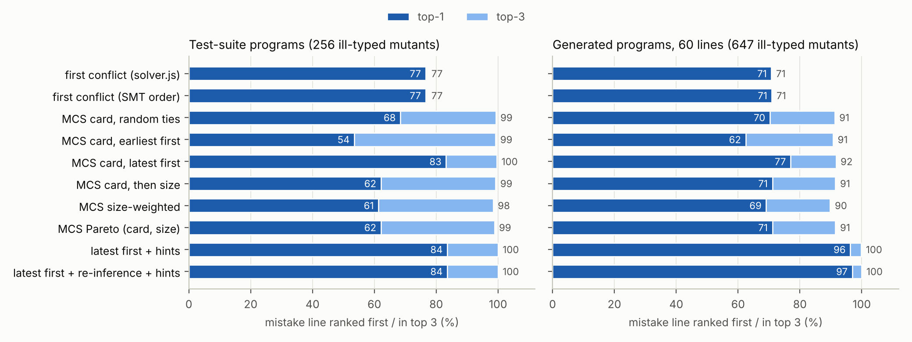
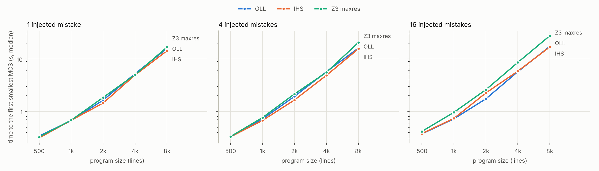

# SAT/SMT-Based Type Error Localization for a Core JavaScript Subset

When type inference fails, a conventional checker reports the **first conflict it
meets**, which is often not where the mistake is:

```js
const p = Promise.resolve("42");   // the mistake: "42" instead of 42
const a = p.then(s => s * 2);
const b = p.then(t => t - 1);
```

The union-find solver of this repository (`solver.js`) blames line 2. The
localizer added here asks a different question: *which lines can be dropped,
as few as possible, so that the rest of the program is typable?* Dropping line 1
alone removes every conflict, while lines 2 and 3 would both have to go, so line
1 is the best candidate:

```
$ python -m localizer examples/promise.js
examples/promise.js: type error.

Suspicious lines (card-late, oll):
   1. line 1      const p = Promise.resolve("42");                            (candidate #1)
   3. line 2      const a = p.then(s => s * 2);                               (candidate #2)
   3. line 3      const b = p.then(t => t - 1);                               (candidate #2)

Correction subsets (dropping the constraints of these lines makes the rest typable):
  #1  {1}  (1 line(s), 4 constraint(s))
  #2  {2, 3}  (2 line(s), 18 constraint(s))

A first-conflict checker (solver.js) blames: line 2
```

When the mistake is *missing* code, which no line's constraints can reveal, a
small repair search names what is missing:

```
$ python -m localizer examples/missing_await.js
examples/missing_await.js: type error.

Likely missing code (this edit makes the program well typed):
  line 3    await p

Suspicious lines (card-late, oll):
   1. line 3      const w = p;                                                (missing code)
   2. line 4      return w * k;                                               (candidate #1)
   ...
```

(The command exits with status 1 when it finds a type error, like a checker.)

This README explains everything that was built for the proposal
*SAT/SMT-Based Type Error Localization for a Core JavaScript Subset*: the design,
why it is correct, the benchmark, the answers to the three research questions,
and the six improvements made after the first version, with the measurements
behind them.

**Contents**

1. [Summary](#summary)
2. [Quick start](#quick-start)
3. [Architecture](#architecture)
4. [Step 1: constraints with source lines](#step-1-constraints-with-source-lines)
5. [Step 2: the SMT encoding and why it is correct](#step-2-the-smt-encoding-and-why-it-is-correct)
6. [Step 3: smallest correction subsets](#step-3-smallest-correction-subsets)
7. [Step 4: ranking the candidates](#step-4-ranking-the-candidates)
8. [Benchmarks](#benchmarks)
9. [Results](#results)
10. [The six improvements after the first version](#the-six-improvements-after-the-first-version)
11. [The inferencer: what was found and fixed](#the-inferencer-what-was-found-and-fixed)
12. [Limitations and threats to validity](#limitations-and-threats-to-validity)
13. [Reproducing everything](#reproducing-everything)
14. [Repository map](#repository-map)
15. [References](#references)

---

## Summary

What was done, following the plan of the proposal:

| Proposal plan | What exists now |
|---|---|
| Weeks 1–2: constraints with source lines | `infer.js --json` tags every constraint with the line (and AST node, statement) it comes from; library signatures are marked hard. `solver.js --json` records which constraint caused each conflict. |
| Weeks 1–2: SMT encoding + correctness argument | `localizer/encode.py`: types are an algebraic datatype, fields and signatures uninterpreted functions, `+` a disjunction, one selector literal per line. [Correctness argument](#24-correctness-argument) plus an empirical cross-check: the encoding agrees with `solver.js` on **all 132** test programs and on 1,827 of 1,828 mutated programs. |
| Weeks 3–4: smallest correction subsets | `localizer/mcs.py`: core-guided MaxSMT (**OLL**), **implicit hitting sets** (MaxHS-style, with RC2 as the hitting-set solver), and Z3's built-in MaxSMT as a reference, all enumerating minimal correction subsets in order of cost. Tests check that all three agree and that every result is a minimal correction subset. |
| Week 5: ranking (Q2) | `localizer/rank.py`: cardinality with several tie-breaking rules, program-derived weights, Pareto-optimal correction subsets, and a learned tie-breaker. |
| Week 6: benchmarks | `bench/mutate.js` (six kinds of mistakes), `bench/generate.py` (well-typed programs of any size, optionally of independent modules), about 7,700 evaluated programs. |
| Week 7: experiments (Q1–Q3) | `bench/run_experiments.py`, `bench/report.py`, `bench/train_ranker.py`, results in [`results/`](results/summary.md). |
| (extension) | Optional **closed-world fields** (`--closed-fields`): a disjunctive constraint, beyond what unification can express, that catches misspelled property names. |

The six improvements made after the first version
([details](#the-six-improvements-after-the-first-version)):

| # | Improvement | Result |
|---|---|---|
| 1 | **Learned tie-breaking** from def/use and code features | Top-1 86% (test suite) / 88% (generated) against 83% / 77% for the best fixed rule, on programs not seen in training; but no gain when trained on the *other* corpus, so it stays opt-in (`--strategy learned`). |
| 2 | **Faster large programs**: eliminating line-local variables, slicing, automatic core minimization | 8,000-line programs: OLL 36–43 s → 16–17 s, IHS 35–52 s → 14–17 s, with the same optima; programs of 8 independent modules: 36 s → 4 s (slicing). |
| 3 | **Missing code**: repair hints for a forgotten `return` or `await` | Forgotten `return`/`await` in the generated programs: top-1 from 0% to 100% (130/130 hints correct, no hint on any other mistake). Overall top-1 on generated programs 77% → 96%. |
| 4 | **Finer units of blame** (statement, expression) and **re-inference** without a line | Method chains split over lines are localized per link; re-inference repairs the cases where `infer.js` guessed later types from the mistake (generated: top-1 96% → 97%). |
| 5 | **Fixes to the inferencer** found by the SMT encoding | `solver.js` and the encoding now agree on 99.9% of mutants (was 97%); no more spurious conflicts on large well-typed programs (was 7 in 20). One expected test output changed. |
| 6 | **Real buggy programs** | A buggy/fixed-pair evaluation pipeline (`bench/realworld.py`). Not run on real data: the environment could not reach any source of real buggy programs (see [item 6](#6-real-buggy-programs)). |

Main findings (details in [Results](#results)):

* **Q1.** For a single mistake whose line carries the conflicting constraints,
  the mistake line is a smallest correction subset in 99–100% of the cases. It
  is often **not the only one**: the smallest correction subset is unique in
  only 41–55% of the cases. The approach fails systematically when the
  mistake is *missing code*. A forgotten `return` changes a constraint on the
  function header, not on the line where the code is missing, so the mistake
  line is never a candidate (0%). A forgotten `await` is a candidate but always
  ties. A small repair search (improvement 3) closes this gap.
* **Q2.** Ranking by cardinality puts the mistake line in the top 3 in 92–100%
  of the cases (99–100% leaving out forgotten `return`s), against 71–77% for
  a first-conflict checker. For the top-1, the tie-breaking rule decides, and the
  best fixed rule depends on the kind of mistake: "latest line first" (77–83%
  overall) wins for mistakes at a use site, "fewer constraints first" for
  mistakes at a definition site. A learned tie-breaker reaches 86–88% on unseen
  programs of the same kind, but encodes the style of the benchmark rather than
  something general. With repair hints and re-inference, the full pipeline
  reaches **84% (test suite) and 97% (generated programs) top-1, and 100% top-3**.
* **Several mistakes.** With 2–6 mistakes, the MCS ranking ("latest first") still has
  77–79% of the effective mistakes among its first answers, and the full
  pipeline 81–86%, while the first-conflict checker drops to 45–52%.
* **Q3.** All three algorithms localize programs of 8,000 lines (≈28,700
  constraints) with up to 16 mistakes, without timeouts. With the performance
  improvements, OLL and IHS take 14–17 s (before: 35–52 s) and are now faster
  than Z3's built-in MaxSMT (17–28 s). IHS needs about three times as many SAT
  calls as OLL, but each is cheap. Programs made of independent parts profit
  most: slicing brings 8,000 lines of 8 modules down to 4–7 s.
* The declarative encoding exposed **order dependence and missing checks in
  the existing solver** (`solver.js`); they are now fixed (improvement 5).

---

## Quick start

Requirements: Node.js ≥ 18, Python ≥ 3.10.

```bash
npm install
```

```bash
pip install -r requirements.txt
```

Localize the type error of a program:

```bash
python -m localizer examples/promise.js
```

Options:

| option | effect |
|---|---|
| `--strategy {card,card-late,card-size,size,pareto,learned}` | ranking (default `card-late`, the most robust rule in the experiments) |
| `--algorithm {oll,ihs,z3}` | MCS algorithm (default `oll`) |
| `--group-by {line,statement,node}` | unit of blame (default `line`) |
| `--reinfer` | also check candidate lines by re-running inference without them |
| `--no-hints` | do not look for missing code (forgotten `return`/`await`) |
| `--closed-fields` | reading a field that no object literal or write defines is an error |
| `--top N`, `--json` | number of lines shown, machine-readable output |

A well-typed program prints the types of a model, with `?` for the parts that
no constraint determines:

```bash
python -m localizer Tests/Async/promises_1.js
```

Tests:

```bash
./run_tests.sh
```

```bash
python -m pytest tests -q
```

---

## Architecture

```
                         program.js
                             │
                             ▼
                 node infer.js --json          (constraint generation, tagged with
                             │                  source lines; --ignore-lines L)
          constraints  [{text: "T4 <= Promise<T2,T3>", line: 1, node: "CallExpression", ...}, ...]
              ┌──────────────┴────────────────────────┐
              ▼                                       ▼
   node solver.js --json                    python -m localizer
   union-find, constraints in order         ┌──────────────────────────────────────────┐
   → first conflict (the baseline)          │ constraints.py  parse the terms           │
                                            │ encode.py       Z3 formula, one selector  │
                                            │                 literal per line          │
                                            │ simplify.py     eliminate local variables │
                                            │ slicing.py      keep conflicting parts    │
                                            │ mcs.py          smallest correction       │
                                            │                 subsets: OLL / IHS / Z3   │
                                            │ rank.py         ranked suspicious lines   │
                                            │ features.py     learned tie-breaking      │
                                            │ reinfer.py      re-inference without a line│
                                            │ repair.py/.js   hints for missing code    │
                                            │ baseline.py     first conflict, SMT order │
                                            └──────────────────────────────────────────┘
```

* **`infer.js`** (existing; extended) walks the AST of the program and emits typing
  constraints. With `--json` every constraint carries its origin.
* **`solver.js`** (existing; extended and fixed) solves the constraints with
  union-find and records the constraint that caused each conflict. Its first
  conflict is the "first-conflict checker" of the proposal.
* **`localizer/`** (new, Python) encodes the constraints into SMT and computes
  and ranks smallest correction subsets.
* **`bench/`** (new) contains the mutation tool, the program generator, the
  experiment drivers and the real-data pipeline; **`results/`** has their output.

---

## Step 1: constraints with source lines

**What changed in `infer.js`.** Inference already separated constraint generation
from solving: `infer.js` prints the constraints and `solver.js` reads them. The
following was added; the text output stays the same.

1. **Origins.** The three inference entry points (`inferExpr`, `inferStmt`,
   `inferExprStmt`) push the AST node they work on onto a stack (`withNode`).
   Every constraint records the innermost node being inferred when it was
   generated: its line, column, end position and node type. Constraints are
   attributed to the innermost node on purpose: in

   ```js
   const x = foo(
     "42",
     b);
   ```

   the constraint `T <= str` of the literal is on line 2, while the constraint
   linking the argument to the parameter belongs to the call on line 1.
   `Program` and `BlockStatement` are skipped, so a block's constraints belong to
   the construct that owns the block. A method call or member access is located
   at the method or property *name*, so each link of a chain split over lines
   (`p\n  .then(f)\n  .catch(g)`) has its own line. Every constraint also records
   its innermost statement (for `--group-by statement`).

2. **Hard library constraints.** Signatures of library functions (`summaries.js`,
   `stubs.js`, the built-in string and array methods) are instantiated lazily
   and **cached**: `arr.push` on line 3 and on line 5 share one method type, whose
   signature constraints were generated while inferring line 3. If those
   constraints belonged to line 3, "dropping line 3" would also remove the
   signature used by line 5. Everything generated inside `asLibrary(...)` is
   therefore tagged `source: "library"` and treated as **hard**: it can never be
   dropped. The constraint linking a call's argument to the parameter stays
   with the line of the call.

3. **Field access kinds.** Field constraints `x <= {f: T}` are tagged as `read`,
   `write`, `literal` (object literal) or `computed-write`, and numeric indexing
   `x[0]` as `index`. The closed-world extension uses these tags.

4. **Line facts.** For every line, the names it declares, assigns and uses, and
   whether it contains literals, calls, member accesses, `await`, `return` or a
   function header (for the learned tie-breaker).

5. **`--ignore-lines L`** infers the program as if line L contributed nothing,
   neither constraints nor the type hints that `infer.js` derives from them
   (for re-inference, improvement 4).

`node infer.js --json file.js` prints the constraints in the same order as the
text output:

```json
{"id": 7, "kind": "sub", "text": "s__then_cb_T8__global <= num", "source": "program",
 "line": 2, "col": 17, "endLine": 2, "endCol": 22, "node": "BinaryExpression",
 "stmtLine": 2, "stmtCol": 0, "stmtEndLine": 2}
```

**What changed in `solver.js`.** It accepts the JSON (as well as the text) on
stdin. With `--json` it prints `{conflicts, types}`, where each conflict names
the constraint, and hence the line, that was being processed when it was
found. Internally, the 26 `this.errors.push(...)` calls became
`this.reportError(...)`, which records the current origin. (It was also fixed in
several places, see [improvement 5](#5-fixes-to-the-inferencer).)

---

## Step 2: the SMT encoding and why it is correct

### 2.1 Types

```
Type = Num | Str | Bool | Void | Regexp | Error           base types
     | Obj(Id) | Arr(Id) | Fun(Id) | Prom(Id)             structured types
     | Res(Id) | Rej(Id)                                  Promise resolver / rejector
     | Cls(Int, Id) | Inst(Int, Id)                       class #n / instance of class #n
```

`Id` is an uninterpreted sort. A structured type carries only an *identity*; its
components are **uninterpreted functions** of the type:

| component | function |
|---|---|
| field `f` of an object (or attribute of an instance) | `field_f : Type → Type` (one per field name) |
| array element | `elem : Type → Type` |
| i-th parameter, result of a function | `param_i : Type → Type`, `ret : Type → Type` |
| resolve / reject type of a promise | `pres`, `prej : Type → Type` |
| method `m` of a class: j-th signature slot, arity | `member_m_j : Type → Type`, `arity_m : Type → Int` |

Two consequences matter:

* **Equal types have equal components** (congruence), which is exactly what
  unification does when it merges two equivalence classes. Types that are never
  unified can get different identities and therefore independent components.
* Components are functions of an identity, not constructor arguments, so a type
  may refer to itself (`o.self = o`). This matches `solver.js`, which has no
  occurs check.

### 2.2 Constraints as formulas

| constraint (as printed by infer.js) | formula |
|---|---|
| `x <= y` | `x = y` |
| `x <= num` / `x <= str\|regexp` | `x = Num` / `x = Str ∨ x = Regexp` |
| `x <= {}` | `is_Obj(x)` |
| `x <= {f: T, g: U}` | `(is_Obj(x) ∨ (is_Inst(x) ∧ arity_f(x) = 1 ∧ …)) ∧ field_f(x) = T ∧ field_g(x) = U` (open records: *at least* these fields) |
| `x <= Array<T>` | `is_Arr(x) ∧ elem(x) = T` |
| `x <= Array<T>` from `x[0]` (tagged `index`) | `(is_Arr(x) ∧ elem(x) = T) ∨ (x = Str ∧ T = Str)` (strings are indexable) |
| `x <= Func<n>{P1 -> P2 -> R}` | `is_Fun(x) ∧ param_0(x) = P1 ∧ param_1(x) = P2 ∧ ret(x) = R` |
| `x <= Promise<A,B>` | `is_Prom(x) ∧ pres(x) = A ∧ prej(x) = B` |
| `x <= Class<C>[m: P -> R, a: T]` | `is_Cls(x) ∧ cls_name(x) = #C ∧ arity_m(x) = 2 ∧ field_m(x) = P ∧ member_m_1(x) = R ∧ …` |
| `void <= x` (literal on the left) | as `x <= void` |
| `plus(a, b, r)`  (`r = a + b`) | `(a = Num ∧ b = Num ∧ r = Num) ∨ ((a = Str ∨ b = Str) ∧ r = Str)` |
| `union(a, b, r)`  (`r = c ? a : b`), `logical_union` (`&&`, `\|\|`) | `r = a ∨ r = b` |
| `index(o, i, r)`  (`r = o[i]`, also `o[i] = r`) | `(is_Arr(o) ∧ i = Num ∧ r = elem(o)) ∨ (is_Obj(o) ∧ i = Str) ∨ (o = Str ∧ i = Num ∧ r = Str)` |
| `tpl(x)` (`` `${x}` ``) | `true` |

Nested type literals (e.g. `Array<{}>`) get a fresh auxiliary variable. The
typing rule for `+` follows TypeScript: numeric addition, or concatenation
when one operand is a string. `solver.js` now uses the same rule
(improvement 5); `--plus lenient` reproduces its old, more permissive rule.

### 2.3 Lines as groups

For every source line `L` there is a selector literal `sel_L`, and the
constraints of line `L` are asserted as `sel_L → (c1 ∧ … ∧ ck)`. Library
constraints are asserted unconditionally. "Dropping line L" means assuming
`sel_L` false. (With `--group-by statement` or `node` the groups are
statements or AST nodes instead of lines; everything below is the same.)

### 2.4 Correctness argument

The goal is that the formula has a model **exactly when** the constraints
have a solution, and that a model **is** a solution. Then nothing is lost
and nothing is invented, and correction subsets of the formula are correction
subsets of the program.

**Semantics of the constraints.** A *type graph* is a set of nodes `N`, each
labelled with a constructor (`num`, …, `obj`, `arr`, `fun`, `prom`, …), with one
canonical node per base type, and partial edge functions `field_f`, `elem`,
`param_i`, `ret`, `pres`, `prej`, … between nodes. Type graphs represent
regular (possibly infinite) trees, which is what union-find without an occurs
check computes. A *typing* of a constraint set `C` is a type graph together
with a map `σ` from type variables to nodes such that every constraint holds
when read as in the table above, with `x = y` meaning `σ(x) = σ(y)`, `is_Obj(x)`
meaning that `σ(x)` is labelled `obj`, `elem(x)` meaning the `elem` edge, and so on.

**Claim 1 (no typing is lost, no model is spurious).** `Φ(C)` is satisfiable
iff `C` has a typing.

* *(⇒)* Let `M` be a model. Take as nodes the values of sort `Type` in `M`, label
  each by its outermost constructor, and take as edges the interpretations of
  the function symbols in `M`; let `σ(x) = M(x)`. Each conjunct of the encoding
  of a constraint is literally the condition required of the typing, evaluated
  in `M` (auxiliary variables of nested literals provide the witness nodes).
  Base constructors are nullary, so each base type is a single canonical value.
* *(⇐)* Given a typing, let the domain of `Id` be the set of nodes and map each
  node `n` to the value `K(n)`: the nullary constructor of a base node, or the
  constructor of `n` applied to `n` itself as its identity (`Cls`/`Inst` also
  get the class number). `K` is injective. Interpret every function symbol `ℓ`
  by `ℓ(K(n)) = K(ℓ-edge of n)` where the edge exists (arbitrarily elsewhere),
  each variable by `K(σ(x))`, and each auxiliary variable by `K` of its witness.
  Every conjunct holds by construction.

The essential point is the identity argument: two structured types are equal
values **iff** they are the same node. So the formula can neither identify
two types the typing keeps apart, nor separate two that it identifies.

**Claim 2 (selectors).** For a set `K` of lines, the formula is satisfiable
under the assumptions `{sel_L | L ∈ K}` iff the hard constraints together with
the constraints of the lines in `K` are satisfiable. (⇐: set the other selectors
false. ⇒: drop the guarded conjuncts.) Hence the correction subsets of the
formula, i.e. sets of selectors to falsify, are exactly the correction subsets
of lines, and a minimum-weight correction subset is the complement of an optimal
MaxSMT solution with soft constraints `sel_L` of weight `w(L)`.

**Claim 3 (relation to the union-find solver).** For constraints of the form
`x <= y` and `x <= pattern`, solvability is unification over rational trees
with open records. Union-find with propagation of components, which is what
`State.union`/`process` in `solver.js` does, decides it **provided every pair of
incompatible constructors is checked**. The encoding found two missing checks
(Promise against object and against array), which are now added. The
disjunctive constraints (`+`, `?:`, `&&`/`||`, `o[i]`) are outside unification.
`solver.js` resolved them after the main pass in a single pass, which was order
dependent; it now iterates them to a fixpoint (improvement 5). The encoding
states them declaratively, so the order of the constraints does not matter.

**Empirical cross-check.**

* All 132 test programs: the encoding is satisfiable exactly when `solver.js`
  reports no conflict (`tests/test_localizer.py::test_agrees_with_solver_js`;
  13 ill-typed, 119 well-typed).
* 1,828 mutated programs (761 from the test suite, 1,067 generated). Before the
  fixes of improvement 5 the verdicts agreed on 1,774 (97%), and every
  difference was a program `solver.js` accepted and the encoding rejected:
  `+` on a boolean, `void` or object (20), a Promise used as an object or array
  (23), arrays mixed with numbers (8), indexing a number (3). **After the fixes
  they agree on 1,827 (99.9%).** The remaining program uses an array method on a
  string. `solver.js` still treats such a variable as `str | Array<T>`, because
  in its text input it cannot tell indexing (`s[0]`, legal on strings) from an
  array method.
* Generated well-typed programs: all are accepted by the encoding and, after the
  fixes, by `solver.js` (before: spurious conflicts on 2/20 programs of 400
  lines and 7/20 of 1,600 lines).

### 2.5 Extension: closed-world fields

With open records, `user.nmae` (a misspelled read) is not a type error: the
object simply gains a field `nmae`. A unification-based checker cannot do
better, because the constraint needed is not an equation: *a field that is read
must be defined somewhere*. As a formula this is a disjunction over the
definitions in the program, which the SMT encoding can express directly
(`--closed-fields`):

* `closed(x)` holds for every object created by an object literal (`{...}`,
  including `{}`);
* a read `x.f` of a closed object requires a definition of `f` on an object
  equal to `x` whose line is kept:
  `closed(x) → ∨_{definitions d of f} (sel_{line(d)} ∧ x = y_d)`, where
  definitions are literal fields, writes `y.f = …`, library fields, and computed
  writes `y[k] = …` (which may define any field);
* reads with a default value (`const {a = 0} = obj`) need no definition.

On the 132 test programs this changes no verdict (no false positives), and it
more than doubles the number of misspelled-property mutants that are detected
(29 → 64 on the test suite).

```
$ python -m localizer examples/misspelled_property.js --closed-fields
...
  #1  {1}  (1 line(s), 5 constraint(s))
  #2  {3}  (1 line(s), 4 constraint(s))       <- line 3: "hi " + user.nmae
```

---

## Step 3: smallest correction subsets

A **correction subset** is a set of lines whose removal leaves a satisfiable
formula; a **minimal correction subset (MCS)** has no smaller correction subset
inside it. With positive weights, a minimum-cost correction subset is always
minimal. All algorithms live in `localizer/mcs.py` behind one interface,
`make(algorithm, encoding, weights=...).enumerate()`, and yield MCSs in
order of **non-decreasing cost**.

**OLL, core-guided MaxSMT** (Andres et al. 2012; Morgado et al. 2014; the
algorithm in RC2):

1. Solve under the assumption that all soft literals hold.
2. If unsatisfiable, take the unsat core `K` (shrunk by re-solving under it and,
   for formulas of up to 300 groups, by deletion), and add `w_min(K)` to the
   lower bound. Lower every weight in `K` by `w_min`, then introduce a
   cardinality output `o_2` with `AtLeast(¬K, 2) → o_2`, and the new soft literal
   `¬o_2` ("at most one of `K` is violated") of weight `w_min`. When a soft
   literal `¬o_k` appears in a core, it is relaxed to `¬o_{k+1}`.
3. If satisfiable, the lines whose constraints the model violates form an
   optimal correction subset. Its cost equals the lower bound, and the code
   asserts this.

Weights are handled with stratification (heaviest literals first).

**IHS, implicit hitting sets** (Davies & Bacchus 2011, MaxHS):

1. Collect disjoint cores first: assume all lines, take a core, stop assuming
   its lines, repeat until satisfiable.
2. Repeat: compute an **optimal hitting set** `H` of all cores collected so far,
   using PySAT's RC2 MaxSAT solver incrementally. Check the program without the
   lines of `H`. If it is satisfiable, `H` is an optimal correction subset;
   otherwise add the new core.
3. Between optimal hitting sets, cheap greedy hitting sets harvest more cores
   (as in MaxHS).

**Z3** uses its built-in MaxSMT (`Optimize`, core-guided *maxres*) as a reference.

**Enumeration.** After an MCS `M` is reported, the clause `∨_{L ∈ M} sel_L`
("keep at least one line of `M`") is added (to the hitting-set problem in IHS)
and the search continues. This excludes `M` and all its supersets. The next
optimum is again minimal: a cheaper correction subset inside it would either have
been found already (and then its supersets are excluded) or would contradict
optimality. All three algorithms therefore produce the MCSs in order of cost.

**Smaller formulas, same MCSs** (improvement 2). Two transformations shrink the
formula before the search without changing its MCSs:

* *Local variables* (`simplify.py`). About 70% of the type variables occur in
  the constraints of a single line. If `x` occurs only in group `G` and `G`
  contains `x = y`, then `sel_G → (x = y ∧ φ(x))` can be replaced by
  `sel_G → φ(y)`: `x` is unconstrained outside `G`. A union-find over these
  equations renames such variables away. It never merges two classes that both
  contain a variable used elsewhere, because such an equation only holds while
  its line is kept.
* *Slicing* (`slicing.py`). Lines and type variables form a graph, and its
  connected components share no variables, so a model of the whole is a model of
  each component (structured types carry identities from an uninterpreted
  sort, which can be chosen apart). A line in a component that is satisfiable on
  its own is never in an MCS, so such components are dropped. The largest
  component is kept unchecked, so slicing never costs a check of the big formula.

**Checks** (`tests/test_localizer.py`). On every ill-typed test program, and on
generated programs with six mistakes and random weights, the three algorithms
produce the same sequence of costs. Every MCS is verified to be a correction
subset (the rest is satisfiable) and minimal (adding back any one of its lines
makes it unsatisfiable). Simplification and slicing are checked to yield the
same smallest MCSs. OLL also checks at run time that the cost of its model
equals its lower bound. That check caught a real bug during the experiments
(cardinality outputs of different cores could share a variable name), and
the weighted test now guards against it.

**First-conflict baselines** (`localizer/baseline.py`):

* **`solver.js`**: the lines of the conflicts it reports, in the order it meets them;
* **SMT order**: the same strategy under the SMT semantics. The shortest
  unsatisfiable prefix of the constraint sequence, found by binary search since
  unsatisfiability is monotone in the prefix, ends with the constraint that is
  blamed. To get a ranked list, that line is dropped and the search continues.
  This baseline isolates the effect of the *strategy* from the semantic
  differences between `solver.js` and the encoding.

---

## Step 4: ranking the candidates

The candidates are ordered, then flattened into a list of lines. A line's
**rank** is the number of distinct lines in the candidates up to and including the
first candidate that contains it. Lines inside one candidate are counted
pessimistically: in the example above, lines 2 and 3 both get rank 3.

| strategy | order of the candidates |
|---|---|
| `card` | fewest lines first; ties in source order (earliest line first) |
| `card-late` | fewest lines first; ties: latest line first (the default) |
| `card-size` | fewest lines first; ties: fewer constraints first |
| `size` | weight of a line = number of constraints it generates, i.e. blame as little of the program as possible (the cost of Pavlinovic et al. is the size of the blamed expressions) |
| `pareto` | two criteria at once, (number of lines, number of constraints). Every Pareto-optimal correction subset is an MCS, because both criteria grow with the set (Terra-Neves et al. 2018), so the front is computed among the enumerated MCSs. The Pareto-optimal candidates come first, then the front of the rest, and so on (non-dominated sorting). |
| `learned` | fewest lines first; ties ordered by a model trained on the mutants (improvement 1) |

Two additions can run on top of any strategy:

* **Hints for missing code** (on by default): repairs that add a `return` or an
  `await` and remove at least one conflict are shown first (improvement 3).
* **Re-inference** (`--reinfer`): lines that make the program well typed when
  inference is run again without them become single-line candidates
  (improvement 4).

For the analysis, the experiments also report **random tie-breaking**: the
probability that the mistake line is first, or in the top 3, when candidates of
equal size are shown in random order (500 shuffles).

---

## Benchmarks

### Mistakes (`bench/mutate.js`)

Each operator changes one line of a correct program, so the line of the
mistake is known:

| operator | example | kind |
|---|---|---|
| `literal` | `42` → `"42"`, `"42"` → `42`, `true` → `"true"` | wrong value (the proposal's example) |
| `swap-args` | `f(a, b)` → `f(b, a)` | swapped arguments |
| `misspell-prop` | `o.name` → `o.naem` | misspelled property |
| `missing-await` | `await p` → `p` | forgotten `await` (missing code) |
| `wrong-var` | `x` → the most recently declared other variable in scope | wrong variable |
| `remove-return` | `return e;` → `e;` | forgotten `return` (missing code) |

Mutants that are still well typed are not type errors and are excluded from
the localization metrics (but counted in the detection tables).

### Corpora

| corpus | base programs | evaluated programs |
|---|---|---|
| **test suite** | the 119 well-typed programs of `Tests/` (the 13 ill-typed ones excluded) | up to 6 mutants per operator and program: 761 mutants, each with open fields (+ re-inference and hints), closed fields, statement and node grouping |
| **generated** | 40 generated programs of 60 lines (`bench/corpus/generated/`), accepted by both checkers | 1,069 mutants, the same four settings; balanced over operators (the test suite has a single `await`) |
| **several mistakes** | 20 generated programs of 200 lines (`bench/corpus/multi/`) | k ∈ {1, 2, 3, 4, 6} mistakes on distinct lines, 3 samples each: 300 programs |
| **scaling** | generated programs of 500 – 8,000 lines, and programs of 8 independent modules of 2,000 and 8,000 lines, 2 per size | k ∈ {1, 4, 16} mistakes (modular: {1, 4}): 38 programs, 264 timed runs |

The **generator** (`bench/generate.py`) builds programs from templates that use
earlier variables of the right type: numbers, strings, booleans, arrays,
objects with fields, named and arrow functions, promises with `then`, `async`
functions with `await`, loops and conditionals. Lines therefore depend on each
other the way they do in real code. With `--modules k` it concatenates k
independent parts (own names), like the separate modules of real code. It avoids
the remaining imprecisions of the inferencer (listed below); base programs
that either checker rejects are skipped.

### Metrics

* **top-k**: share of the ill-typed mutants whose mistake line has rank ≤ k;
* Q1 facts per mutant: is the mistake line alone a correction subset (also after
  re-inference)? Is it in a smallest MCS? How many smallest MCSs are there?
* several mistakes: a mistake is *effective* if it is a type error on its own
  (benign ones cannot be found by any method); precision of the first MCS, and
  recall of the effective mistakes in the first MCS and in the first *e* ranked
  lines (*e* = number of effective mistakes);
* scaling: time until the first optimal MCS (encoding, slicing and solving),
  number of SAT calls, timeouts (300 s).

---

## Results

All numbers below come from `results/*.csv` and are reproduced by
`python bench/report.py` and `python bench/train_ranker.py` (full tables:
[`results/summary.md`](results/summary.md), [`results/learned.md`](results/learned.md)).

### Which mutants are type errors

| mistake | test suite: mutants | type errors: solver.js / SMT / SMT + closed fields | generated: mutants | type errors: solver.js / SMT / SMT + closed fields |
|---|---|---|---|---|
| literal | 324 | 138 / 138 / 138 | 240 | 190 / 190 / 190 |
| swap-args | 20 | 6 / 6 / 6 | 125 | 57 / 57 / 57 |
| misspell-prop | 127 | 29 / 29 / **64** | 240 | 158 / 158 / **173** |
| missing-await | 1 | 0 / 0 / 0 | 72 | 72 / 72 / 72 |
| wrong-var | 250 | 78 / 78 / 78 | 240 | 116 / 117 / 117 |
| remove-return | 39 | 5 / 5 / 5 | 152 | 53 / 53 / 53 |
| **all** | 761 | 256 / 256 / 291 | 1,069 | 646 / 647 / 662 |

Many mutants are still well typed: a string literal that is only concatenated
can become a number, a swapped pair of arguments can have the same type. These
are not type errors, so no checker can report them, and they are left out of
the localization results. With the fixes of improvement 5, `solver.js` and the
encoding find the same errors (one exception, see §2.4). Closed-world fields
more than double the misspelled properties found in the test suite.

### Q1: does the smallest correction subset point to the real mistake?

| mistake | ill-typed (test suite / generated) | mistake line is in a smallest MCS (%) | the smallest MCS is unique (%) | equally small MCSs (mean) |
|---|---|---|---|---|
| literal | 138 / 190 | 100 / 99 | 49 / 88 | 1.6 / 1.2 |
| swap-args | 6 / 57 | 100 / 100 | 100 / 100 | 1.0 / 1.0 |
| misspell-prop | 29 / 158 | 100 / 100 | 7 / 49 | 2.0 / 1.6 |
| missing-await | – / 72 | – / 100 | – / **0** | – / 2.4 |
| wrong-var | 78 / 117 | 100 / 100 | 33 / 36 | 1.8 / 1.8 |
| remove-return | 5 / 53 | 80 / **0** | 80 / 28 | 1.2 / 2.5 |
| **all** | 256 / 647 | 100 / 92 | 41 / 55 | 1.7 / 1.6 |

**Mostly yes, as long as the mistake is on a line whose constraints take part
in the conflict.** For wrong values, swapped arguments, misspelled
properties, wrong variables and even forgotten `await`s, the mistake line is
a smallest correction subset in 99–100% of the cases. The assumption behind it,
that most of the program is right, holds by construction for a single
mistake: the mistake line alone explains every conflict. The few exceptions
(1–2% of wrong literals and wrong variables) come from `infer.js` itself: a
mistake can change the constraints it generates for *other* lines, through
its eager type hints (after `const s2 = 0` instead of a string, a later
`s2.toUpperCase()` is inferred as a field access on an object). Re-inference
without the line (improvement 4) removes them: on the generated programs the
mistake line alone becomes a correction subset in 100% of these cases.

**But a smallest MCS is often not unique.** It is unique in only 41% (test
suite) and 55% (generated programs) of the cases. Two lines that contradict
each other once give two equally small candidates, and nothing in the
constraints says which one is wrong. The smallest MCS is unique when the
evidence is unbalanced, e.g. a wrong literal in a definition that has several
uses (88% unique in the generated programs). That is exactly the case where a
first-conflict checker blames a use instead (the example at the top).

**It fails when the mistake is missing code.**

* *Forgotten `return`* (0% in the generated programs): `return e;` → `e;`
  leaves the line with constraints that are still consistent. (The 4 of 5 found
  in the test suite are one-line callbacks, `function (n) { return n > 1; }`,
  where the `return` and the header share a line.) The change shows up
  elsewhere: `infer.js` adds `void <= ret` for a function without `return`
  **on the function's header line**. The smallest MCSs are the header (with
  "earliest first" it is the top candidate in all 50 such cases) and the call
  site. They blame the right function, but never the right line.
* *Forgotten `await`* (100% in a smallest MCS, 0% unique): the line
  `const w = p;` still carries the binding that conflicts, so it is a
  candidate. But so are the use of `w` and often the definition of the
  promise, which tie (2.4 equally small candidates on average).

Both are now handled by repair hints (improvement 3).

### Q2: which candidate should be shown first?



Generated programs, one mistake, top-1 / top-3 (%):

| method | literal | swap-args | misspell-prop | missing-await | wrong-var | remove-return | **all** |
|---|---|---|---|---|---|---|---|
| first conflict (solver.js) | 85 / 85 | 100 / 100 | 96 / 96 | 0 / 0 | 76 / 76 | 0 / 0 | 71 / 71 |
| first conflict (SMT order) | 85 / 85 | 100 / 100 | 96 / 96 | 0 / 0 | 77 / 77 | 0 / 0 | 71 / 71 |
| MCS card, random ties | 91 / 99 | 100 / 100 | 74 / 99 | 44 / 99 | 65 / 99 | 0 / 0 | 70 / 91 |
| MCS card, earliest first | **94** / 99 | 100 / 100 | 49 / 98 | 65 / 100 | 38 / 97 | 0 / 0 | 62 / 91 |
| MCS card, latest first | 89 / 99 | 100 / 100 | **99** / 100 | 0 / 100 | **97** / 100 | 0 / 0 | 77 / 92 |
| MCS card, then size | 93 / 99 | 100 / 100 | 64 / 100 | 76 / 100 | 60 / 99 | 0 / 0 | 71 / 91 |
| MCS size-weighted | 93 / 99 | 100 / 100 | 56 / 95 | 76 / 100 | 60 / 97 | 0 / 0 | 69 / 90 |
| MCS Pareto (card, size) | 93 / 99 | 100 / 100 | 64 / 100 | 76 / 100 | 60 / 99 | 0 / 0 | 71 / 91 |
| latest first + hints | 89 / 99 | 100 / 100 | 99 / 100 | **100** / 100 | 97 / 100 | **100** / 100 | 96 / 100 |
| latest first + re-inference + hints | 91 / 100 | 100 / 100 | 99 / 100 | **100** / 100 | 98 / 100 | **100** / 100 | **97** / 100 |
| (ill-typed mutants) | 190 | 57 | 158 | 72 | 117 | 53 | 647 |

On the test-suite programs (256 ill-typed mutants) the totals are: first
conflict 77 / 77, latest first 83 / 100, latest first + re-inference + hints
84 / 100 ([`results/summary.md`](results/summary.md)).

* **Top-3: the smallest correction subsets almost always contain the mistake.**
  With any of the MCS rankings, the mistake line is among the first three
  suspicious lines in 98–100% of the test-suite mutants and 90–92% of the
  generated ones; the gap there is exactly the forgotten `return`s, and with
  hints it closes (100%). A first-conflict checker has a single answer, so its
  top-3 is no better than its top-1: 77% and 71%.
* **Top-1: the tie-breaking rule decides, and the best fixed rule depends on the
  kind of mistake.** With random tie-breaking, MCSs are about as good as the
  first conflict at top-1 (68% vs 77%; 70% vs 71%): the balanced conflicts lose
  half of their points to a coin flip.
  * *Latest line first* is the best fixed rule (83% test suite, 77%
    generated). For a use-site mistake (wrong variable 96–97%, misspelled
    property 99–100%) the later of two conflicting lines is the use. In a tie
    this rule agrees with the first-conflict checker, which also blames the
    later constraint; it beats that checker when the evidence is unbalanced.
    But it always misses a forgotten `await` (0%), where the mistake is at the
    definition `const w = p` and the conflict at the later use.
  * *Fewer constraints first*, size weights (blame as little code as
    possible, the cost of Pavlinovic et al.) and the Pareto ranking all prefer
    simple lines. That helps when the mistake is a simple definition (forgotten
    `await` 76%, wrong literal 93%) and hurts at use sites (wrong variable 60%,
    misspelled property 56–64%). The Pareto ranking over (lines, constraints)
    gives the same order as "fewest lines, then fewest constraints" here.
  * A **learned** tie-breaker (improvement 1) combines these signals and reaches
    86% (test suite) and 88% (generated) on programs it was not trained on.
* **Hints and re-inference** take the full pipeline to 97% top-1 and 100% top-3
  on the generated programs.

### Unit of blame

Latest first, top-1 / top-3 (%):

| unit | test suite | smallest MCS unique | generated | smallest MCS unique |
|---|---|---|---|---|
| line (default) | 83 / 100 | 41% | 77 / 92 | 55% |
| statement | 83 / 100 | 42% | 79 / 99 | 55% |
| AST node | 83 / 98 | 11% | 80 / 95 | 29% |

Statements and lines coincide almost everywhere in these programs. The higher
top-3 for statements comes from forgotten `return`s: the whole function
declaration is one statement, which *contains* the line of the missing
`return` but is not more precise than the header line. AST nodes are finer
units, which makes ties much more frequent (the smallest MCS is unique in 11%
of the test-suite mutants). Being more precise about where in a line the
mistake is costs certainty about which candidate it is.

### Closed-world fields

| corpus | fields | misspelled-property mutants found | MCS latest first: top-1 / top-3 (%) | first conflict (SMT): top-1 / top-3 (%) |
|---|---|---|---|---|
| test suite | open | 29 / 127 | 100 / 100 | 97 / 97 |
| test suite | closed | **64** / 127 | 86 / 86 | 84 / 84 |
| generated | open | 158 / 240 | 99 / 100 | 96 / 96 |
| generated | closed | **173** / 240 | 99 / 100 | 94 / 94 |

Closed-world fields find many more misspelled properties (×2.2 in the test
suite, where objects are built with `{}` and assignments), with no false
positives on the 132 test programs. The new errors are harder to localize: most
of the misses are misspelled *writes* (`obj.scoer = 55`), which are like deleted
definitions of `score`, so the conflict appears at the reads of `score`. That
is missing code again.

### Several mistakes

Generated programs of 200 lines with *k* mistakes on distinct lines. A
mistake is *effective* if it is a type error on its own; benign mistakes
cannot be found by any method, so recall is measured against the effective
ones. The last four columns give the share of the effective mistakes among the
first *e* suspicious lines (%), where *e* is the number of effective mistakes.

| mistakes k | ill-typed programs | effective mistakes e (mean) | first MCS: size / precision / recall | first conflict | MCS latest first | MCS learned | full pipeline |
|---|---|---|---|---|---|---|---|
| 1 | 39 / 60 | 1.00 | 1.00 / 62% / 62% | 72 | 79 | 82 | **95** |
| 2 | 56 / 60 | 1.50 | 1.95 / 60% / 72% | 45 | 78 | 79 | **86** |
| 3 | 58 / 60 | 2.03 | 2.47 / 65% / 75% | 47 | 79 | 79 | **83** |
| 4 | 59 / 60 | 2.56 | 2.97 / 64% / 72% | 47 | 77 | 77 | **82** |
| 6 | 60 / 60 | 3.80 | 4.22 / 63% / 69% | 52 | 78 | 76 | **81** |

With several mistakes the first-conflict strategy degrades quickly: only
45–52% of the effective mistakes are among its first *e* answers. It keeps
blaming consequences, and one mistake can cause several conflicts. The MCS
ranking keeps 77–79% of them, independent of *k*. A smallest correction
subset covers all conflicts at once, so each mistake needs only one of its
lines in it. About 60–65% of the lines of the first MCS are mistakes; the others
are the other side of a tie. The learned tie-breaker (trained on single
mistakes) adds nothing here beyond *k* = 1. Hints for missing code help at every
*k*: a hint is accepted when the edit removes at least one conflict (the
smallest correction subset of the edited program gets smaller), so it works
while other mistakes are still present. All the hints given in these 300
programs pointed at an actual mistake.

### Q3: how does it scale?



The figure shows the current configuration. The tables give the median time in
seconds to the first smallest MCS, including encoding and slicing, before →
after the performance improvements (improvement 2). Two
programs per size; no run hit the 300 s timeout, and all algorithms and
configurations found the same optimum on every program.

| lines | constraints | mistakes | smallest MCS (mean) | OLL | IHS | Z3 maxres |
|---|---|---|---|---|---|---|
| 1,000 | 3,566 | 16 | 7.5 | 1.0 → 0.7 | 1.3 → 0.7 | 1.0 → 1.0 |
| 2,000 | 7,168 | 16 | 10.0 | 3.1 → 1.7 | 4.3 → 2.3 | 3.1 → 2.6 |
| 4,000 | 14,360 | 16 | 11.0 | 11.7 → 5.7 | 14.2 → 5.8 | 9.5 → 8.6 |
| 8,000 | 28,694 | 1 | 0.5 | 43.2 → 15.9 | 37.6 → 14.3 | 21.8 → 16.8 |
| 8,000 | 28,692 | 4 | 3.5 | 35.7 → 16.1 | 35.1 → 15.6 | 25.8 → 20.6 |
| 8,000 | 28,689 | 16 | 13.5 | 41.7 → 17.3 | 51.8 → 16.9 | 32.8 → 27.6 |

Programs of 8 independent modules (slicing keeps only the modules with a conflict):

| lines | mistakes | lines left after slicing | OLL | IHS | Z3 maxres |
|---|---|---|---|---|---|
| 2,000 | 1 | 315 | 1.6 → 1.1 | 1.4 → 1.1 | 1.8 → 1.0 |
| 2,000 | 4 | 420 | 2.1 → 1.1 | 1.7 → 1.1 | 1.9 → 1.1 |
| 8,000 | 1 | 1,243 | 35.9 → 4.0 | 33.1 → 3.9 | 21.7 → 4.2 |
| 8,000 | 4 | 2,884 | 35.5 → 6.6 | 33.8 → 6.1 | 24.6 → 7.1 |

(all sizes from 500 lines: [`results/summary.md`](results/summary.md))

* **All three scale to programs of 8,000 lines** (≈28,700 constraints) with
  16 mistakes. With the improvements, the time grows about as the size to the
  power 1.5 (8 times the lines, 23–25 times the time for OLL; before: 40–60
  times), and much more slowly with the number of mistakes.
* **The cost of the SAT calls dominates, not the encoding.** At 8,000 lines
  encoding takes 2.3 s and slicing 0.8 s; the rest is solving. Before the
  improvements, OLL made 70 SAT calls (most of them to shrink cores) and IHS
  208; now 16 and 44.
* **OLL and IHS are now faster than Z3's maxres** at 8,000 lines (14–17 s against
  17–28 s); before, Z3 was the fastest (22–33 s against 35–52 s). Z3 profits
  less because its internal MaxSMT does not use our core handling. IHS makes about
  three times as many SAT calls as OLL: each optimal hitting set is checked
  against the SMT formula, and the cores are collected one by one. When the
  calls are cheap that hardly matters, and IHS ends up as fast as OLL.
* **Independent parts are where slicing pays off**: in a program of 8 modules
  only the modules with a mistake are solved, and 8,000 lines take 4–7 s
  instead of 22–36 s.

---

## The six improvements after the first version

### 1. Learned tie-breaking

*Problem.* Ties are inherent (Q1), and every fixed tie-breaking rule wins on
some kinds of mistakes and loses on others (Q2).

*What was done.* `infer.js --json` reports per-line facts: declared, assigned
and used names, literals, calls, member accesses, `await`, `return`, function
headers. `localizer/features.py` describes each line *relative to the other
candidates of its tie*:

* its position in the tie;
* whether it defines a name another tied line uses, or uses a name defined
  there;
* its size (number of constraints) and how many lines use what it declares;
* what kind of code it contains;
* how often it occurs in the enumerated MCSs.

`bench/train_ranker.py` fits a conditional-logit model, a softmax over the
candidates of a tie, on the stored tiers of all single-mistake mutants. It
evaluates the model only on held-out data: with 5-fold cross-validation
*grouped by program* (mutants of one program are never split between training
and test), and across corpora.

*Result* ([`results/learned.md`](results/learned.md)), top-1 / top-3 (%):

| rule | test suite (256) | generated (647) |
|---|---|---|
| earliest first | 54 / 99 | 62 / 91 |
| latest first | 83 / 100 | 77 / 92 |
| fewest constraints, then latest | 66 / 100 | 74 / 91 |
| random | 68 / 99 | 70 / 91 |
| **learned, 5-fold CV by program** | **86** / 100 | **88** / 92 |
| learned, trained on the other corpus | 83 / 100 | 76 / 92 |

By kind of mistake (cross-validated, both corpora), the learned rule gets the
forgotten `await` right in 100% of the cases (latest first: 0%) while keeping
misspelled properties at 98% and wrong variables at 91%. The largest weights
of the final model: a line with a literal (+1.4), a declaration (+0.9), a line
that uses a name another tied line defines (+0.8) or accesses a member (+0.8)
is more likely the mistake; a line with a `return` (−1.5) or with many
constraints (−1.2) less likely.

*Conclusion.* Within a kind of program the learned rule is clearly better. But
it does not transfer: trained on the test suite and applied to the generated
programs (or the other way round) it is no better than "latest first". Its
weights partly describe how the benchmark's programs and mistakes are written
(e.g. the generated `async` functions always end with `return w * k`). Without
real mistakes to train on, it cannot be called a better *general* rule.
`latest first` therefore remains the default, and `--strategy learned` uses
the shipped model (`localizer/ranking_model.json`, trained on all mutants).

### 2. Faster large programs

*Problem.* On large programs the first satisfiability check of the whole
formula dominates the time (Q3).

*What was done* (see [Step 3](#step-3-smallest-correction-subsets) for why the
results are unchanged):

* type variables local to one line are eliminated (`simplify.py`, on by default);
* the formula is sliced to the components that contain conflicts
  (`slicing.py`, on by default);
* cores are minimized only for formulas of up to 300 groups;
* `generate.py --modules` builds programs of independent parts to measure
  slicing.

*Result.* Each change alone, and all together (OLL, median seconds; in
parentheses the SAT calls):

| lines | mistakes | before | no core minimization | eliminate local variables | slicing | all (now) |
|---|---|---|---|---|---|---|
| 2,000 | 1 | 2.5 (8) | 1.7 (3) | 1.6 (8) | 2.3 (8) | 1.6 (3) |
| 2,000 | 16 | 3.1 (52) | 2.0 (12) | 2.6 (50) | 3.3 (49) | 1.7 (12) |
| 8,000 | 1 | 43.2 (4) | 22.3 (2) | 24.5 (4) | 34.7 (4) | 15.9 (2) |
| 8,000 | 4 | 35.7 (20) | 22.0 (6) | 25.0 (20) | 36.9 (20) | 16.1 (6) |
| 8,000 | 16 | 41.7 (70) | 23.6 (16) | 29.3 (68) | 39.6 (68) | 17.3 (16) |

The two largest effects: on large formulas every deletion step of core
minimization is a SAT call on the whole formula (70 → 16 calls), and
eliminating line-local variables makes every call cheaper. Slicing alone
helps little on these generated programs, because their lines are almost all
connected into one component (it removes about 3% of the lines). On programs
of independent modules it is the decisive step (see [Q3](#q3-how-does-it-scale)):
8,000 lines in 8 modules go from 36 s to 4 s. All configurations and all
algorithms found the same optimum on every program.

### 3. Missing code: a forgotten `return` or `await`

*Problem.* Missing code has no constraints, so no correction subset can contain
it (Q1).

*What was done.* For the lines the ranking finds most suspicious,
`localizer/repair.js` proposes two kinds of small edits:

* add a `return` to a function without one whose header is suspicious or that
  is called on a suspicious line (its last expression statement becomes
  `return …`);
* add an `await` to the value of a declaration or assignment in an `async`
  function.

`localizer/repair.py` keeps the edits that remove at least one conflict, i.e.
the smallest correction subset of the edited program is smaller than the
original one. With a single mistake this means the edited program is well
typed; with several mistakes, the other mistakes may remain. The kept edits are
shown as **hints**, ranked before the correction subsets.

*Result.* On both corpora every forgotten `return` and `await` that is a type
error got a correct hint (130 of 130), and none of the other 773 ill-typed
mutants got a hint. On the generated programs, top-1 for these kinds goes from
0% to 100%, and the overall top-1 from 77% to 96%, at a cost of about 0.07 s per
program. In the test suite, forgotten `return`s go from 80% to 100%. With
several mistakes, hints raise the share of mistakes found among the first
answers from 77–79% to 81–86% (see [Several mistakes](#several-mistakes)). The two kinds of edits match two of the mutation operators. They
target the "missing code" case that Q1 identified, but how often real mistakes
are of these two kinds is not known from this benchmark.

### 4. Finer units of blame and re-inference

*Problems.* A line can hold several statements, and a statement can span lines
(method chains were all blamed on their first line). And `infer.js` derives
types for later lines from earlier ones (type hints), so a mistake can change
the constraints of other lines.

*What was done.*

* The location of a member access or method call is now its name, so each link
  of a chain has its own line.
* `--group-by statement|node` makes statements or AST nodes the unit of blame
  (§2.3).
* `infer.js --ignore-lines L` infers the program as if line L contributed
  nothing, neither constraints nor type hints. `localizer/reinfer.py` (`--reinfer`)
  runs it for the lines related to the candidates, and those after which the
  program is well typed become single-line candidates.

*Result.* See [Unit of blame](#unit-of-blame): statements change little, and AST
nodes trade certainty for precision. On the generated programs, re-inference
makes the mistake line a correction subset in all the wrong-literal and
wrong-variable mutants where type hints had hidden it. It raises their top-1
from 96% to 97% (wrong literals 89% → 91%). In the test suite, two such cases
remain; both involve `typeof` guards, which `infer.js` handles with its own
shadow variables. It costs about one extra inference per related
line, about 1 s for a 50-line program, so it is opt-in.

### 5. Fixes to the inferencer

*Problem.* The SMT encoding disagreed with `solver.js` on 3% of the mutants, and
`solver.js` reported spurious conflicts on large well-typed programs.

*What was done.* The findings 1–8 of the first version were fixed (listed in
[the next section](#the-inferencer-what-was-found-and-fixed)), with the encoding
as the reference.

*Result.* Agreement on 1,827 of 1,828 mutants (was 1,774); no spurious
conflicts on 60 well-typed generated programs of up to 1,600 lines (was 7 of
20 at 1,600 lines); all 132 regression tests still pass. Only one expected
output changed (`Tests/Functions/ArrowFuncExpr_2.out`): the parameters of
`(name, greeting) => greeting + ", " + name` are no longer guessed to be strings,
since any value can be concatenated with a string.

### 6. Real buggy programs

*Problem.* All the results above are on mistakes introduced by mutation.

*What was done.* `bench/realworld.py DIR` evaluates pairs `NAME.buggy.js` /
`NAME.fixed.js`, such as a student's failed submission and the next accepted
one, or the two sides of a bug-fixing commit. The lines changed by the fix are
the mistake lines; for an insertion (missing code), the lines next to it. It
reports how many bugs the type system sees at all (buggy ill-typed, fixed well
typed) and top-1/top-3 for every method. `bench/realworld/pipeline-check/`
only checks that the script works; it is not a data set.

*Not done: the real data.* No source of real buggy programs was reachable from
the environment in which this was built. Its network policy refused the
Stack Exchange API (`api.stackexchange.com`), Hugging Face (`huggingface.co`),
Zenodo (`zenodo.org`) and IBM's Project CodeNet download host
(`dax-cdn.cdn.appdomain.cloud`). Public GitHub repositories other than this one
were out of the session's scope. The datasets that were found do not fit as
they are. [tsbugs](https://arxiv.org/html/2601.21186v1) (bugs of TypeScript
projects) mostly involves generics, interfaces and `null` handling, which this
type system does not model. The
[Stack Overflow edit pairs](https://arxiv.org/pdf/2308.12079) are mostly
compiler errors other than type errors. To run it:

* put pairs in a directory and run `python bench/realworld.py DIR`; or
* allow one of the hosts above under *Network access → Allowed domains* in the
  environment's settings ([docs](https://code.claude.com/docs/en/cloud-environments#network-access)).
  Project CodeNet's JavaScript submissions are a good candidate: a rejected
  submission followed by an accepted one from the same author gives real
  buggy/fixed pairs.

---

## The inferencer: what was found and fixed

Building a second, declarative solver next to the union-find solver turned up
the following. Items 1–8 were fixed (improvement 5); 9–11 remain.

1. **Order dependence of deferred constraints in `solver.js`** — *fixed.* `+`,
   `?:` and `&&`/`||` were resolved after the main pass, once, with heuristics
   such as "`str + unknown` makes the unknown a string". In

   ```js
   function label(text, k) {
     const head = text.toUpperCase();
     return head + k;          // k is still unknown when this + is resolved
   }
   const xs = [1, 2, 3];
   const n = xs.length + 2;    // n = num, but this + is resolved later
   const s = label("a", n);
   ```

   `k` became `str`, and the later resolution of `n` conflicted
   (`examples/order_dependence.js`). The deferred constraints are now resolved
   to a fixpoint: precise rules first, one-sided inferences only when nothing
   else applies, defaults at the very end. The guess is gone.
2. **A Promise was never checked against an object or an array** — *fixed*
   (`_initObj`, `_initArr`; also Promise against function and function against
   object, for symmetry).
3. **Arrays mixed with every base type** (`[1, 2] * 2` was accepted) — *fixed*:
   only strings may also be used like arrays (`str | Array<T>`, for `s[0]`).
4. **`+` accepted any operands** except a number with an object (`true + 1`,
   `void + 1`, `{} + {}`) — *fixed*: numbers, or a string on either side, as in
   TypeScript. **Indexing a number** (`i[i]`) — *fixed*: strings are indexable,
   other base types are not.
5. **Cached method instances were monomorphic** (`a.map(f)` and `a.map(g)` with
   different result types conflicted) — *fixed*: `map`, `flatMap`, `reduce` get a
   fresh instance per use.
6. **Computed writes conflicted with arrays** (`arr[i] = v` added `arr <= {}`) —
   *fixed*: a computed write is an index constraint, like a computed read.
7. **`String(n)`, `console.log(n)` conflicted with numbers** (their summaries
   declared an object parameter) — *fixed*: they accept any value.
8. **`const n = s.length` and `s.slice(...)` on a string variable without a type
   hint** made the variable an object — *fixed*: one helper handles property
   reads on receivers of unknown type, and methods that strings and arrays share
   (`slice`, `indexOf`, `includes`, `concat`, `at`) no longer constrain the
   receiver.
9. **Eager type hints.** `infer.js` decides some method dispatches using types
   guessed from *earlier* lines, so the constraints of a line can depend on
   other lines. This is a design decision of the inferencer; re-inference
   (improvement 4) compensates for it in the localizer.
10. **No block scopes** (new). `let`/`const` variables get one type variable per
    function, so `for (let i ...)` loops at the same level share `i`, and two
    loops whose `let x` hold different types would conflict. Fixing it would
    rename many type variables in the expected test outputs, so it is left as is;
    the generator uses a separate loop variable per module.
11. **Strings with array methods** (`s.push(1)` on a string) are still accepted
    as `str | Array<T>` by `solver.js` (see §2.4).

---

## Limitations and threats to validity

* **No real mistakes yet.** All mistakes are introduced by mutation
  (improvement 6 explains why). The mutation operators decide where mistakes
  are, and the tie-breaking results depend on it: `wrong-var` and
  `misspell-prop` change a use, `literal` mostly a definition. That is why the
  per-operator tables matter more than the totals, and why the learned rule is
  not the default.
* **The repair hints** cover exactly the two kinds of missing code the mutation
  operators produce; other missing code (a missing argument, a missing
  property) is not covered.
* **Granularity.** By default the unit of blame is the line; statements and AST
  nodes are available, with the trade-offs shown above.
* **Dropping a line does not re-run inference** unless `--reinfer` is used;
  without it, a few mistakes hide behind type hints (§Q1).
* **Synthetic programs.** The generated programs exercise the core subset, but
  their structure is regular (one definition per line, short functions); the
  test programs are small (5–30 lines), which inflates ties.
* **Timing** was measured on a 4-core cloud machine, 3 programs in parallel.
  Absolute times are indicative; the comparisons between algorithms and
  configurations on the same programs are fair.
* **Semantics.** The encoding follows TypeScript for `+` and indexing; `solver.js`
  now does too. One difference remains (strings with array methods, §2.4).

---

## Reproducing everything

```bash
npm install
```

```bash
pip install -r requirements.txt
```

```bash
./run_tests.sh
```

```bash
python -m pytest tests -q
```

```bash
python bench/run_experiments.py all
```

```bash
python bench/train_ranker.py
```

```bash
python bench/report.py
```

`run_experiments.py all` takes about 30 minutes on 4 cores. The single
experiments are `mutants`, `generated`, `multi` and `scaling`; see `--help` for
sizes, seeds and timeouts. Run `train_ranker.py` after `mutants` and `generated`
(it reads their tiers and writes `localizer/ranking_model.json`). Everything is
seeded and deterministic except the running times. For real buggy programs:
`python bench/realworld.py DIR`.

---

## Repository map

| path | what |
|---|---|
| `infer.js` | constraint generation (existing); `--json` with source origins and line facts, `--ignore-lines`; fixes |
| `solver.js` | union-find solver (existing); `--json` with the constraint of each conflict; fixpoint for deferred constraints; fixes |
| `summaries.js`, `stubs.js`, `gen_stubs.js` | library signatures (existing) |
| `Tests/`, `run_tests.sh` | regression tests of the inferencer (existing; one expected output updated) |
| `localizer/terms.py` | parser for the type terms printed by `infer.js` |
| `localizer/constraints.py` | runs `infer.js --json` / `solver.js --json`, constraint data model |
| `localizer/encode.py` | SMT encoding, groups (line/statement/node), closed-world fields, printing models |
| `localizer/simplify.py` | elimination of group-local type variables |
| `localizer/slicing.py` | slicing to the components that contain conflicts |
| `localizer/mcs.py` | OLL, implicit hitting sets, Z3; MCS enumeration |
| `localizer/rank.py` | ranking strategies, Pareto fronts, random tie-breaking |
| `localizer/features.py`, `localizer/ranking_model.json` | learned tie-breaking: features and the trained model |
| `localizer/reinfer.py` | re-inference without a line |
| `localizer/repair.js`, `localizer/repair.py` | hints for a forgotten `return` or `await` |
| `localizer/baseline.py` | first-conflict baselines |
| `localizer/__main__.py` | command line (`python -m localizer`) |
| `tests/test_localizer.py` | tests of the localizer |
| `bench/mutate.js` | mutation tool |
| `bench/generate.py` | generator of well-typed programs (optionally of independent modules) |
| `bench/evaluate.py`, `bench/run_experiments.py`, `bench/report.py` | experiments |
| `bench/train_ranker.py` | training and cross-validation of the learned tie-breaker |
| `bench/realworld.py`, `bench/realworld/` | evaluation on buggy/fixed pairs |
| `bench/corpus/` | the generated base programs used in the experiments |
| `results/` | CSV results, `summary.md`, `learned.md`, plots |
| `examples/` | the small programs used in this README |
| `docs/inferencer-constructs.md` | the JavaScript constructs `infer.js` supports (the previous README) |

---

## References

1. Z. Pavlinovic, T. King, T. Wies. *Finding minimum type error sources.* OOPSLA 2014.
2. C. Loncaric, S. Chandra, C. Schlesinger, M. Sridharan. *A practical framework for type inference error explanation.* OOPSLA 2016.
3. S. Fu, T. Dwyer, P. J. Stuckey, J. Grundy. *Goanna: resolving Haskell type errors with minimal correction subsets.* arXiv:2405.12697, 2024.
4. J. Davies, F. Bacchus. *Solving MAXSAT by solving a sequence of simpler SAT instances.* CP 2011.
5. M. Terra-Neves, I. Lynce, V. Manquinho. *Multi-objective optimization through Pareto minimal correction subsets.* IJCAI 2018.
6. B. Andres, B. Kaufmann, O. Matheis, T. Schaub. *Unsatisfiability-based optimization in clasp.* ICLP 2012 (OLL).
7. A. Morgado, C. Dodaro, J. Marques-Silva. *Core-guided MaxSAT with soft cardinality constraints.* CP 2014.
8. A. Ignatiev, A. Morgado, J. Marques-Silva. *RC2: an efficient MaxSAT solver.* JSAT 2019 (PySAT's RC2, used for hitting sets).
9. N. Bjørner, A.-D. Phan, L. Fleckenstein. *νZ – an optimizing SMT solver.* TACAS 2015 (Z3's MaxSMT).
